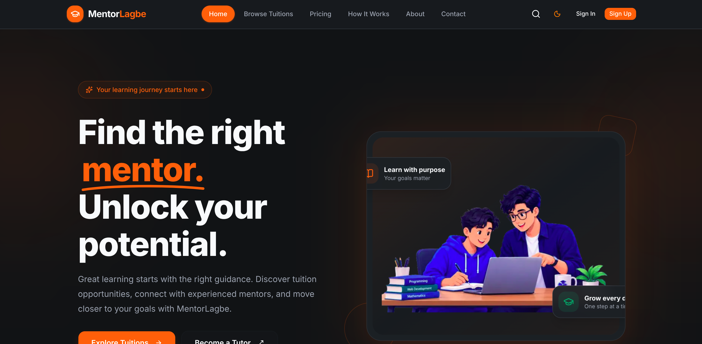

# MentorLagbe — Smart Tuition & Mentorship Platform

<p align="center">
  
</p>

<p align="center">
  A modern tuition and mentorship marketplace connecting students with qualified tutors.
</p>

<p align="center">
  <a href="https://mentor-lagbe-web.vercel.app/">Live Website</a> •
  <a href="https://mentor-lagbe-web-server.vercel.app/">Backend API</a>
</p>

---

## Overview

**MentorLagbe** is a full-stack Smart Tuition & Mentorship Platform designed to connect students with tutors through a convenient and structured online marketplace.

Students can discover tuition opportunities, explore tutor profiles, bookmark interesting listings, and apply for suitable tuition posts. Tutors can publish and manage tuition posts, while administrators oversee platform activities.

The platform also includes subscription-based features with Free and Pro plans and Stripe payment integration.

## Features

### Authentication & Authorization

- Secure authentication with Better Auth.
- Role-based access for Students, Tutors, and Admins.
- Protected dashboard routes.
- Session-based authentication and backend JWT integration.

### Student Features

- Browse and search available tuition posts.
- View detailed tuition information.
- Apply for tuition opportunities.
- Bookmark and manage saved tuitions.
- Free and Pro subscription plans.
- Personalized student dashboard.

### Tutor Features

- Create and publish tuition posts.
- Edit, delete, activate, and close tuition listings.
- Manage tuition applications.
- Free and Pro subscription plans.
- Personalized tutor dashboard.

### Admin Features

- Admin dashboard.
- Manage users and platform activities.
- Review and moderate tuition posts.
- Manage tuition applications and transactions.

### Additional Features

- Stripe payment integration.
- ImgBB image upload integration.
- Responsive user interface.
- Dynamic data fetching from the backend.
- Form validation and user feedback.
- Loading states and error handling.

## Technology Stack

| Category           | Technologies        |
| ------------------ | ------------------- |
| Frontend Framework | Next.js             |
| Language           | TypeScript          |
| UI                 | React, Tailwind CSS |
| Components         | shadcn/ui           |
| Authentication     | Better Auth         |
| Notifications      | Sonner              |
| Animation          | Framer Motion       |
| Icons              | Lucide React        |
| Payments           | Stripe              |
| Image Hosting      | ImgBB               |
| Deployment         | Vercel              |

## Live Demo

- **Frontend:** https://mentor-lagbe-web.vercel.app/
- **Backend API:** https://mentor-lagbe-web-server.vercel.app/

## Getting Started

### Prerequisites

- Node.js 20 or later
- npm
- Access to the MentorLagbe backend
- Required authentication and API credentials

### Installation

Clone the repository:

```bash
git clone YOUR_FRONTEND_REPOSITORY_URL
cd mentor-lagbe-web
```

Install dependencies:

```bash
npm install
```

### Environment Variables

Create a `.env.local` file in the project root:

```env
NEXT_PUBLIC_API_URL=http://localhost:5000
```

Add any other environment variables required by your existing Better Auth and application configuration.

For production, configure `NEXT_PUBLIC_API_URL` with the deployed backend URL in Vercel.

### Run Development Server

```bash
npm run dev
```

Open:

```text
http://localhost:3000
```

### Build for Production

```bash
npm run build
```

## Project Structure

```text
mentor-lagbe-web/
├── app/
│   ├── (auth)/
│   ├── (dashboard)/
│   └── (public)/
├── components/
│   ├── dashboard/
│   ├── ui/
│   └── ...
├── lib/
├── public/
│   └── mentor-lagbe-preview.png
├── hooks/
├── types/
└── package.json
```

## Subscription Plans

MentorLagbe offers Free and Pro subscription options for students and tutors.

| Plan | Student             | Tutor                   |
| ---- | ------------------- | ----------------------- |
| Free | Limited bookmarks   | Up to 2 tuition posts   |
| Pro  | Unlimited bookmarks | Unlimited tuition posts |

## Project Goals

- Make finding tutors and tuition opportunities easier.
- Provide tutors with a platform to promote their teaching services.
- Build a secure, role-based marketplace.
- Deliver a responsive and user-friendly experience.

## Author

**Md. Shahidul Islam**

Full Stack Developer

- Portfolio: https://md-shahidul-portfolio.vercel.app/
- GitHub: https://github.com/shahidul91325
- LinkedIn: https://www.linkedin.com/in/shahidul91325

---

<p align="center">
  Built with passion to make learning and teaching more accessible.
</p>
